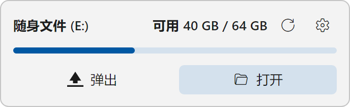
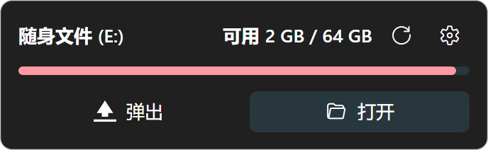
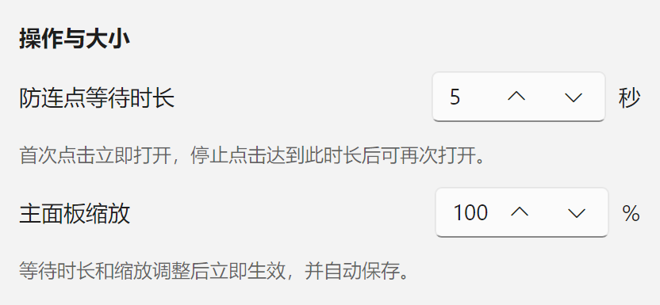

# UsbPulse

[](https://github.com/YU322142/UsbPulse/actions/workflows/build.yml)

**常驻托盘的 U 盘助手：插入即显示，拔出即隐藏。**

UsbPulse 会在任务栏上方显示 U 盘名称、可用与总容量，以及空间占用条。通过“打开”和“弹出”按钮管理设备，多块 U 盘可切换选择。主面板采用 344 像素宽的紧凑布局，保留刷新和设置入口。

[下载最新版本](https://github.com/YU322142/UsbPulse/releases/latest) · [使用说明](#使用) · [MIT 许可证](LICENSE)

> **AI 生成与协作说明：** 本项目使用 OpenAI Codex 辅助开发。本次版本的代码、界面、测试与文档包含 AI 生成或修改的内容，具体参与范围和验证情况见 [AI_DISCLOSURE.md](AI_DISCLOSURE.md)。

## 界面预览

### 浅色模式



### 深色模式与空间不足提示



截图由程序的 Avalonia 界面渲染导出，使用示例设备名称和容量。图中为实色背景；Windows 11 的原生亚克力效果会随桌面背景、主题和系统透明效果设置变化。

## 功能

- **自动显隐**：没有 U 盘时主面板完全隐藏；插入后自动显示，拔掉最后一个设备后隐藏，托盘保持运行。
- **容量可视化**：名称与“可用 / 总容量”同排、同字号显示，进度条表示已用空间；占用达到 90% 时变红。悬停可查看已用容量和百分比，重新显示面板时刷新容量。
- **打开与弹出**：首次点击“打开”立即响应。同一设备连续点击只打开一次，每次重复点击都会重新计时；默认停止点击满 5 秒后才可再次打开，可在设置中调整为 1–60 秒。不同设备独立计时，打开失败可立即重试。
- **多设备管理**：可切换设备，新接入的设备会自动选中；设备名称较长时省略显示，悬停可查看完整名称。
- **大小与外观**：主面板可缩放到 75%–200%，默认 100%，支持跟随系统、浅色、深色主题及六种强调色。
- **Windows 11 背景**：22H2 及以上通过 DWM 请求系统 Desktop Acrylic 和圆角；实际透明效果与已知限制见下文。
- **事件驱动**：Windows 使用设备事件，Linux 使用 UDisks2；空闲时不轮询盘符。默认采用低功耗渲染，可启用高刷新率合成。

## 下载

到 [Releases](https://github.com/YU322142/UsbPulse/releases/latest) 选择对应平台的包。Windows、Linux 和 macOS 的平台包均包含 .NET 运行时。

| 平台 | 下载 |
| --- | --- |
| Windows | [x64](https://github.com/YU322142/UsbPulse/releases/latest/download/UsbPulse-win-x64.zip) · [x86](https://github.com/YU322142/UsbPulse/releases/latest/download/UsbPulse-win-x86.zip) · [ARM64](https://github.com/YU322142/UsbPulse/releases/latest/download/UsbPulse-win-arm64.zip) |
| Linux | [x64](https://github.com/YU322142/UsbPulse/releases/latest/download/UsbPulse-linux-x64.tar.gz) · [ARM64](https://github.com/YU322142/UsbPulse/releases/latest/download/UsbPulse-linux-arm64.tar.gz) · [ARM](https://github.com/YU322142/UsbPulse/releases/latest/download/UsbPulse-linux-arm.tar.gz) |
| Alpine Linux | [musl x64](https://github.com/YU322142/UsbPulse/releases/latest/download/UsbPulse-linux-musl-x64.tar.gz) |
| LoongArch | [Old World ABI 1.0](https://github.com/YU322142/UsbPulse/releases/latest/download/UsbPulse-linux-loongarch64-oldworld-abi1.0.tar.gz) |
| macOS（实验性） | [Intel x64](https://github.com/YU322142/UsbPulse/releases/latest/download/UsbPulse-osx-x64.tar.gz) · [Apple Silicon ARM64](https://github.com/YU322142/UsbPulse/releases/latest/download/UsbPulse-osx-arm64.tar.gz) |
| 已安装 .NET 8 的环境 | [Portable](https://github.com/YU322142/UsbPulse/releases/latest/download/UsbPulse-portable-net8.0.zip)，使用 `dotnet UsbPulse.dll` 启动 |

每次发布附带 `SHA256SUMS.txt`，可用于校验下载文件。

## 使用

1. 解压整个文件夹。Windows 运行 `UsbPulse.exe`；Linux/macOS 运行 `UsbPulse`，LoongArch 使用包内的 `run.sh`。
2. 启动后程序驻留托盘，没有 U 盘时不显示主面板。插入设备后，面板自动出现在任务栏上方。
3. 点击“打开”查看文件，点击“弹出”请求安全移除设备。多设备时先从下拉框中选择目标设备。
4. 右上角的刷新按钮重新读取设备与容量，设置按钮调整外观；右键面板和托盘菜单也提供入口。

在设置中启用“亚克力背景”或修改“高刷新率合成”后，需要重启程序。容量不可读时显示已知的总容量并隐藏占用条。

### 等待时长与主面板缩放

| 设置 | 范围 | 默认值 | 生效方式 |
| --- | --- | --- | --- |
| 防连点等待时长 | 1–60 秒 | 5 秒 | 立即生效，从最后一次点击重新计时 |
| 主面板缩放 | 75%–200% | 100% | 立即调整整个面板的文字、图标与按钮 |

两项设置都会自动保存，重启后恢复。



### 透明效果检查说明

当前请求的是 Windows 11 提供的 Desktop Acrylic 最亮预设。[微软对该预设的定义](https://learn.microsoft.com/en-us/windows/win32/api/dwmapi/ne-dwmapi-dwm_systembackdrop_type)不等同于对任务栏或开始菜单内部材质参数的保证。

本机黑白背景对比中仍观察到实色回退现象，尚未定位全部原因。当前版本不声称透明效果与任务栏、开始菜单完全一致；此项仍待进一步处理。本次新增的等待时长和缩放选项不改变现有背景实现。

### 平台说明

| 平台 | 当前能力与依赖 |
| --- | --- |
| Windows | 自动检测可移动存储，支持打开和弹出。原生 Desktop Acrylic 需要 Windows 11 22H2 或更新版本；较旧系统按支持情况使用兼容背景。 |
| Linux | 使用 `lsblk` 读取设备与容量，使用 `udisksctl` 监听及弹出；需要系统提供 `util-linux`、`udisks2` 和 `xdg-open`。 |
| macOS | 实验性构建，支持打开和弹出；自动检测尚未接入系统事件，需要通过托盘菜单手动刷新。 |

目前已进行 Windows 界面和交互检查。其他平台的自动测试与构建结果可在 [GitHub Actions](https://github.com/YU322142/UsbPulse/actions) 查看。

## 开发与构建

源码使用 C#、.NET 8、Avalonia 和 FluentAvalonia。

```powershell
dotnet restore
dotnet run
dotnet test tests/UsbPulse.Tests/UsbPulse.Tests.csproj -c Release
```

本地生成 Windows 自包含包：

```powershell
dotnet publish UsbPulse.csproj -c Release -r win-x64 --self-contained true -o output/win-x64/UsbPulse
```

自动构建覆盖 Windows、Linux、Alpine、LoongArch 和 macOS。LoongArch 的运行时与原生库来源、校验和及 ABI 处理见 [.github/workflows/build.yml](.github/workflows/build.yml)。

构建、测试与贡献约定见 [CONTRIBUTING.md](CONTRIBUTING.md)。

## 开源许可与 AI 说明

UsbPulse 使用 [MIT License](LICENSE)。第三方组件及其许可见 [THIRD-PARTY-NOTICES.md](THIRD-PARTY-NOTICES.md)。

代码、界面、测试和文档的 AI 协作范围，以及截图来源、验证边界，见 [AI 生成与协作说明](AI_DISCLOSURE.md)。该说明随发布包一同提供。
